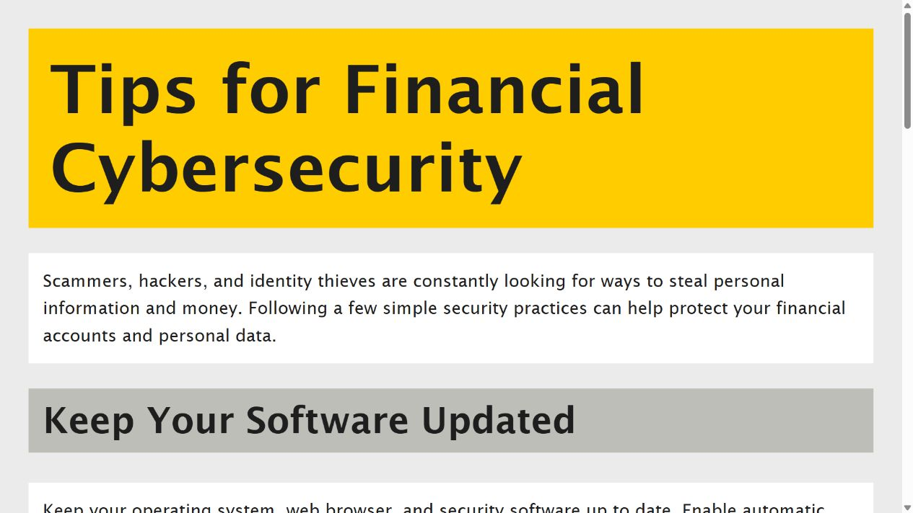

# Financial Cybersecurity Awareness Page

**An HTML and CSS project from my Commonwealth Bank Software Engineering Job Simulation.**

Created by [Tanisha Jain](https://github.com/tanisha-jain19).

This static webpage presents seven financial cybersecurity topics in a simple, readable layout. It is a learning project completed as part of a job simulation, not employment at Commonwealth Bank or an official bank website.

## Preview



## What the page covers

- Software updates and personal information protection.
- Strong, unique passwords and phishing awareness.
- Secure websites and networks.
- Monitoring financial accounts and multi-factor authentication.

## Skills demonstrated

- Structuring a webpage with HTML headings and paragraphs.
- Linking an external stylesheet.
- Using CSS typography, spacing, colors, and the box model.
- Adapting the layout for smaller screens with a media query.

## Run locally

Download or clone this repository, then open **`index.html`** in a browser. Keep `index.css` in the same folder.

Alternatively, with Python installed, run this command from the repository folder:

```bash
python -m http.server 8000
```

Open `http://localhost:8000` in your browser. No package installation, build step, JavaScript, or backend is required.

## Files

| File | Purpose |
| --- | --- |
| `index.html` | Page structure and educational content |
| `index.css` | Original styling plus a small-screen layout adjustment |
| `assets/preview.jpg` | Browser preview of the page |
| `.gitignore` | Excludes local editor and temporary files |

## Project scope and credits

The original HTML/CSS work was prepared during the Commonwealth Bank Software Engineering Job Simulation. Portfolio preparation added standard HTML metadata, mobile styling, this README, and a preview. The original learning files remain separate and unchanged.

Commonwealth Bank is named only to identify the simulation context. This repository is not affiliated with, endorsed by, or operated by the bank. No banking services, login forms, account data collection, or transaction functionality are implemented.

The completion certificate and simulation materials are not included in this code repository. No reuse license is granted for any third-party simulation material.
